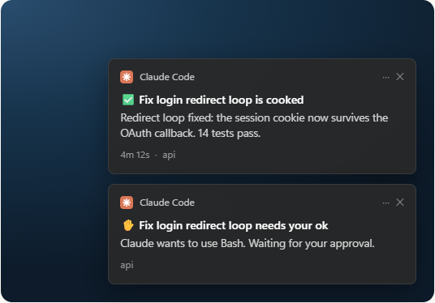

# cooked

Send Claude Code a prompt, go do something else, and let Windows tell you when it's cooked.

A notification pops up when a turn is done, with the session's name, Claude's last line and how
long it took, or the moment Claude is stuck waiting for your permission or an answer. Click it and
you're back in that exact Windows Terminal tab.

Setup takes one paste. In Claude Code:

```
Set up cooked for me: clone https://github.com/dihannahdi/cooked into a temp folder and follow its SKILL.md
```

It asks four things in one dialog, sends a test notification, and cleans up after itself. Nothing
stays in your skill list.

**Website:** [dihannahdi.github.io/skills/cooked](https://dihannahdi.github.io/skills/cooked)



## What you get

**Two kinds of notification, impossible to mix up.** ✅ means a turn is done. ✋ means Claude
needs you. The first character tells you which before you read a word.

**The real content, not a vague ping.** The title names the session, the same name as the tab.
The body is Claude's last line, the exact tool waiting for approval, or the question it asked.
The small print says how long the turn took and which folder it ran in.

**Click to go back.** It jumps to the session's tab in Windows Terminal, even when several
sessions share one window. In other terminals it brings the window to the front.

**Quiet when it should be.** No notification while you're already looking at that tab (unless
you've been idle for 90 seconds, which means you probably walked away). No "done" notification for
turns under 30 seconds. No sound during Do Not Disturb, Focus, a fullscreen game or a presentation.
A new notification from a session replaces its last one, so they don't pile up.

**Your voice, your sound.** Casual English, Indonesian *bahasa gaul*, or your own: setup can read
your recent prompts (on your machine) or a few messages you paste, and write every line the way you
talk. Any mp3, wav or wma works as the sound.

**Optional phone push**, through Claude Code's own Remote Control. Your phone buzzes when Claude
needs you, and when a long task finishes while you're away.

## What setup asks

| | Choices |
| --- | --- |
| Voice | Casual English · Bahasa gaul · My own voice |
| Sound | Windows default · My own file · Silent |
| Done ping | Turns of 30s+ · 60s+ · every turn |
| Phone | No · Yes |

Then it builds a small helper on your machine, adds three hooks to Claude Code's settings, and fires
a test notification so you see it working before you leave.

## Keep `/cooked` as a command (optional)

If you'd rather have it around for later changes:

```bash
git clone --depth 1 https://github.com/dihannahdi/cooked ~/.claude/skills/cooked
```

Then `/cooked` runs setup, and `/cooked voice`, `/cooked sound`, `/cooked test` or
`/cooked uninstall` change one thing. You don't need it, though: everything cooked runs on lives in
`~/.claude/cooked`, including the tools to change or remove it.

## Change or remove it

- Wording: `~/.claude/cooked/copy.json`. Sound and the quiet rules: `~/.claude/cooked/config.json`.
  Changes apply to the next notification.
- Why a notification did or didn't show: `~/.claude/cooked/.state/notify.log`.
- Remove: ask Claude Code to "uninstall cooked". It runs `~/.claude/cooked/cooked.ps1 uninstall` and
  takes the three hooks out of your settings.

## How it works

Claude Code runs [hooks](https://code.claude.com/docs/en/hooks) at fixed moments. cooked uses three:

- `UserPromptSubmit` notes when your prompt started, so it knows how long the turn took.
- `Stop` (a turn finished) and `Notification` (Claude needs permission or an answer) run
  `notify.ps1`, which decides whether to notify, picks the wording and shows a Windows notification.
- Clicking opens a `cooked:` link. `cooked.exe`, compiled from [`runtime/cooked.cs`](runtime/cooked.cs)
  on your machine during setup, finds the tab whose title matches the session and switches to it.

The session name comes from Claude Code's own transcript, read incrementally, so each notification
costs about a second of background work and nothing in tokens.

## Privacy

Nothing leaves your computer. cooked reads the current session's transcript on disk for its name and
last reply, and writes only to `~/.claude/cooked` and two per-user registry keys (the `cooked:` link
and the "Claude Code" notification identity). No admin rights, no network calls.

Phone push is off unless you choose it. If you do, it uses Claude Code's Remote Control, which makes
your sessions reachable from claude.ai under your own account.

## Needs

- Windows 10 or 11 and Claude Code. Windows PowerShell 5.1 and the .NET Framework 4 compiler ship
  with Windows; setup checks both.
- Windows Terminal for click-to-tab. Other terminals get click-to-window.

## Known limits

- Windows only for now. [macOS](https://github.com/dihannahdi/cooked/issues/2) and [Linux](https://github.com/dihannahdi/cooked/issues/3) ports are open for anyone who wants
  them.
- Do Not Disturb is detected through an undocumented Windows state. If it ever misreads, the
  notification still shows; only the sound decision is affected.
- Tabs are matched by title. Two sessions with the same name: the click goes to the first one.

## Contributing

cooked is open source, and help is welcome. The easiest first contribution is a voice in your own
language: one JSON file, no code ([#1](https://github.com/dihannahdi/cooked/issues/1)). The bigger open ones are [macOS](https://github.com/dihannahdi/cooked/issues/2) and
[Linux](https://github.com/dihannahdi/cooked/issues/3) support, and [click-to-tab in more terminals](https://github.com/dihannahdi/cooked/issues/4).
[CONTRIBUTING.md](CONTRIBUTING.md) has the steps.

## License

MIT
